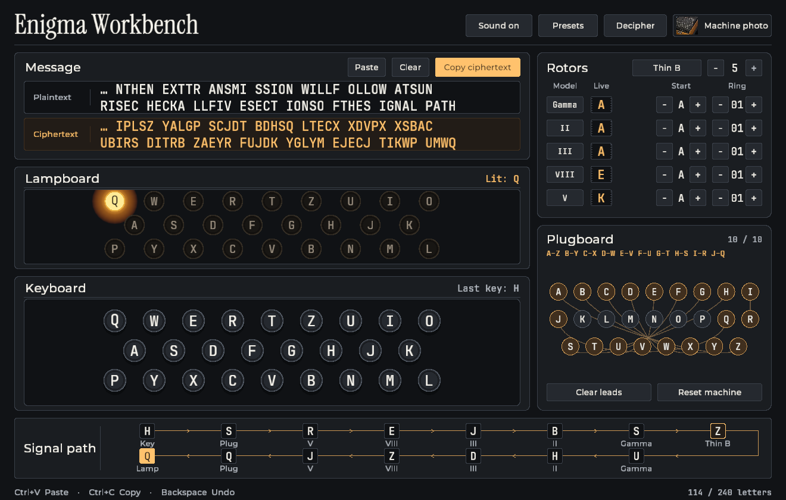

# Enigma Workbench

[](LICENSE)
[](CMakeLists.txt)
[](https://www.vulkan.org/)
[](https://ctrlm0nster.github.io/Enigma/)

An authentic electromechanical Enigma cipher simulator and Turing–Welchman Bombe cryptanalysis engine written in modern C++20.

The project provides two tools:
- **`Enigma`**: An interactive desktop workbench rendered via Vulkan 1.3 with real-time signal path tracing, a physical 26-bulb lampboard, catenary plugboard patch cables, procedurally synthesized mechanical acoustics, and an embedded Bombe decipher panel.
- **`EnigmaBombe`**: A standalone command-line solver for direct message decipherment and multi-threaded crib searches across rotor permutations, ring settings, and plugboard leads.



---

## Technical Overview

### Electromechanical Signal Path

The Enigma cipher machine operates as an electromechanical reciprocal polyalphabetic substitution cipher. Each keystroke mechanically advances the rotor pack before closing an electrical circuit:

```
[Key In] ──► [Stepping Pawls] ──► [Plugboard] ──► [Rotors Right-to-Left] ──► [Reflector]
                                                                                   │
[Output Lamp] ◄── [Plugboard] ◄──────────── [Rotors Left-to-Right] ◄───────────────┘
```

1. **Rotor Stepping**: Pawls advance the rightmost (fast) rotor. Turnover notches engage adjacent pawls to step middle and slow rotors.
2. **Plugboard (*Steckerbrett*)**: Swaps letter pairs through patch cords. Letters without cables pass through straight.
3. **Forward Rotor Pass**: Current traverses right-to-left through the rotors (Fast -> Middle -> Slow -> Greek). Each rotor applies a permutation based on its internal wiring, current rotational position, and ring offset (*Ringstellung*).
4. **Reflector (*Umkehrwalze*)**: Connects contacts in 13 reciprocal pairs, reversing current back through the rotor pack.
5. **Reverse Rotor Pass**: Current returns left-to-right through the inverse wiring of each rotor.
6. **Reverse Plugboard**: Traverses the plugboard a second time (reciprocal swap).
7. **Lampboard (*Glühlampenfeld*)**: Output voltage illuminates the designated letter lamp.

### Reciprocal Invariants

- **Self-encryption impossibility**: Because the reflector wires contacts in distinct disjoint pairs and never connects a contact to itself, no letter can ever encipher to itself:
  $$\forall x \in [A-Z], \quad E(x) \neq x$$
  This mathematical characteristic was the fundamental vulnerability exploited by Marian Rejewski, Alan Turing, and Gordon Welchman.
- **Symmetric reciprocity**: The electrical circuit is entirely passive and bidirectional. For any identical machine state (same rotors, rings, positions, and plug connections):
  $$E(E(x)) = x$$
  Typing ciphertext back into an identically configured machine recovers the plaintext without a separate decipher mode.

### Mechanical Double-Stepping Anomaly

In standard Wehrmacht three-rotor machines, all pawls move forward together with every keypress. The right rotor advances on every stroke. When the middle rotor reaches its turnover notch, it allows the slow rotor's pawl to drop into position. On the next keystroke, the slow rotor steps—and because the middle rotor's ratchet tooth is engaged by its pawl, the middle rotor steps a second time in two consecutive keystrokes:

```
Stroke N-1:  [Slow: A]  [Middle: D]  [Fast: V (Notch)]  ──► Fast reaches notch
Stroke N:    [Slow: A]  [Middle: E]  [Fast: W]          ──► Middle steps once
Stroke N+1:  [Slow: B]  [Middle: F]  [Fast: X]          ──► Middle double-steps, slow advances
```

This simulator implements the authentic left-to-right pawl engagement model, reproducing the historical anomaly across all rotor types.

---

## Emulation Capabilities

### Supported Hardware

| Machine Variant | Rotor Capacity | Reflectors | Historical Service |
| :--- | :--- | :--- | :--- |
| **Enigma I** | 3 active (Rotors I–V) | A, B, C | Wehrmacht Heer & Luftwaffe |
| **Kriegsmarine M3** | 3 active (Rotors I–VIII) | A, B, C | German Naval Surface Fleet |
| **Kriegsmarine M4** | 4 active (Greek + Rotors I–VIII) | Thin B, Thin C | U-boat Fleet (Atlantic Battle) |
| **Expanded Workbench** | Up to 5 configurable rotors | Any | Extended research simulation |

### Rotor Specifications & Notches

- **Rotors I to V**: Single turnover notch:
  - Rotor I: notch at **Q** (advances next wheel stepping from Q to R)
  - Rotor II: notch at **E**
  - Rotor III: notch at **V**
  - Rotor IV: notch at **J**
  - Rotor V: notch at **Z**
- **Naval Rotors VI, VII, VIII**: Authentic dual turnover notches at **Z** and **M** (turning over adjacent wheels twice per revolution).
- **Greek Stationary Wheels (*Beta* and *Gamma*)**: Used exclusively in the Kriegsmarine M4. Positioned next to thin reflectors; they do not rotate during key depressions.
- **Standard Reflectors (*Umkehrwalzen*)**: Reflector A, Reflector B, and Reflector C.
- **Thin Reflectors (*Umkehrwalzen dünn*)**: Thin B (*Bruno*) and Thin C (*Caesar*), specifically dimensioned for the 4-rotor M4 basket.

### Historical Wartime Presets (*Tagesschlüssel*)

Verified WWII daily keys can be loaded with a single click from the **Presets** menu:

1. **Operation Barbarossa (22 Jun 1941)**: Wehrmacht Heer frontline key at the launch of the Eastern Front.
   - Rotors: `II - IV - V` | Reflector: `B` | Rings: `02 21 12` | Start: `W X C`
   - Plugs: `AV BS CG DL FU HZ IN KM OW RX`
2. **U-552 Triton Shark (1 Feb 1942)**: Kriegsmarine M4 4-rotor patrol key during Operation Drumbeat.
   - Rotors: `Beta - II - IV - I` | Reflector: `Thin B` | Rings: `01 20 11 04` | Start: `V J Z E`
   - Plugs: `AT BL DF GJ HM NW OP QY RZ VX`
3. **North Atlantic Wolfpack (14 Dec 1943)**: Kriegsmarine M4 key with dual-notch Rotor VII.
   - Rotors: `Gamma - VII - V - III` | Reflector: `Thin B` | Rings: `12 05 18 22` | Start: `N A V Y`
   - Plugs: `AN EZ HK IJ LR MO QS TU VW XY`
4. **Normandy Invasion (6 Jun 1944)**: German Army Group B command circuit during D-Day.
   - Rotors: `III - I - II` | Reflector: `B` | Rings: `06 14 25` | Start: `D A Y`
   - Plugs: `CH EJ KQ LM PW ST UZ BV AX DF`
5. **Scharnhorst Final Battle (26 Dec 1943)**: Battle of the North Cape naval combat key.
   - Rotors: `III - VI - VIII` | Reflector: `B` | Rings: `01 08 13` | Start: `U Z K`
   - Plugs: `AN BO CP DQ ER FS GT HU IV JX`

---

## Cryptanalysis: The Turing–Welchman Bombe

The cryptanalysis subsystem reproduces the electromechanical solver developed by Alan Turing and Gordon Welchman at Bletchley Park.

```
[Ciphertext + Crib] ──► [Crib Crash Rejection] ──► [Bipartite Menu Construction]
                                                             │
[Ranked Key Candidates] ◄── [Full Replay Verification] ◄── [Diagonal Board Deduction]
```

### 1. Crib Crash Elimination
Scans the ciphertext against a known plaintext phrase (*crib*). Any alignment where a ciphertext character matches the corresponding crib character ($C_i = P_i$) is discarded immediately without evaluating rotor settings, as Enigma can never encipher a letter to itself.

### 2. Bipartite Menu Construction
Viable alignments are converted into an adjacency graph (*menu*). Vertices represent letters, while edges represent the rotor scrambler permutation at that specific character position. Closed cycles in the menu provide the necessary constraint loops.

### 3. Welchman's Diagonal Board Deduction
Gordon Welchman's diagonal board exploits the reciprocal symmetry of the plugboard ($A \leftrightarrow B \iff B \leftrightarrow A$). Hypothesizing an initial plugboard connection propagates constraints throughout the menu graph:
- If a hypothesis forces a letter to connect to two different sockets, a contradiction is detected.
- If a hypothesis requires more than the allowable 10 patch cables, the state is rejected.
- Invalid starting configurations are pruned rapidly without searching the $1.5 \times 10^{14}$ possible plugboard combinations.

### 4. Concurrent Search & Full Tape Verification
The search operates asynchronously via C++20 `std::jthread` with cooperative `std::stop_token` cancellation. When a stop occurs, the candidate settings are verified against the full ciphertext using an independent `EnigmaMachine` instance before reporting the recovered key.

---

## Command-Line Tool (`EnigmaBombe`)

The standalone executable `EnigmaBombe` runs headless cryptanalysis and direct decipherment without graphical or audio dependencies.

### Command Syntax

```
EnigmaBombe decipher --ciphertext TEXT --start ABC --rings 01,01,01 [--plugs AZ,BY]
EnigmaBombe search   --ciphertext TEXT --crib TEXT --rings 01,01,01
                     [--offset N] [--plugs AZ,BY | --known-leads AZ,BY]
                     [--rotors fixed|I-III|I-V] [--reflector B|C|both]
```

- `--ciphertext`: Input text or `-` to read from standard input.
- `--offset`: 1-based character position for the crib. If omitted, scans all viable alignments.
- `--plugs ''`: Specifies an unplugged board (0 patch cables).
- `--known-leads`: Constrains search to partial known plugboard pairs.
- `--rotors`: Search scope (`fixed` for I-II-III, `I-III` for all 6 orders of Rotors I–III, or `I-V` for all 60 five-rotor permutations).
- `--reflector`: Search scope (`B`, `C`, or `both`).

### Examples

**1. Deciphering with known settings:**
```bash
./build/EnigmaBombe decipher --ciphertext "BDZGO" --start AAA --rings 01,01,01
# Output: AAAAA
```

**2. Deciphering with plugboard cables:**
```bash
./build/EnigmaBombe decipher \
  --ciphertext "PKQPVIVQAYMRAT" \
  --start WXC \
  --rings 02,21,12 \
  --plugs AV,BS,CG,DL
# Output: ENIGMAREVEALED
```

**3. Standard input piping:**
```bash
echo "PKQPVIVQAYMRAT" | ./build/EnigmaBombe decipher --ciphertext - --start WXC --rings 02,21,12 --plugs AV,BS,CG,DL
# Output: ENIGMAREVEALED
```

**4. Recovering unknown plugboard leads and start position from a crib:**
```bash
./build/EnigmaBombe search \
  --ciphertext "QXYXZELOUMMZBFQWJVXCAVZQDBBJBISRPATQOGROETQQHPZJGKIRTSIKLLBNHUZPKOKVMBMYICOIBXAKPBMVUWJGXTXSZTHTYVKRUPAL" \
  --crib "HISPREFACESETSUPTHEMESSAGEFORANENIGMADEMONSTRATIONBRINGEXTRAQUIETSUPPLIESFORTHEWEATHERSTATION" \
  --rings 03,02,05
```
Output:
```
Search complete
1/12 viable alignments, 17576 settings tested, 2 crib matches

Rotors I II III  ·  Refl. B
Start ADV | Rings 03 02 05 | Crib position 2
Leads AZ BY CR
THISPREFACESETSUPTHEMESSAGEFORANENIGMADEMONSTRATIONBRINGEXTRAQUIETSUPPLIESFORTHEWEATHERSTATIONNEARZURICH
```

**5. Searching an unplugged machine across rotor orders and reflectors:**
```bash
./build/EnigmaBombe search \
  --ciphertext "BDZGO" \
  --crib "AAAA" \
  --rings 01,01,01 \
  --plugs "" \
  --rotors I-III \
  --reflector both
```
Output:
```
Search complete
2/2 viable alignments, 421824 settings tested, 6 crib matches

Rotors I II III  ·  Refl. B
Start AAA | Rings 01 01 01 | Crib position 1
Leads none
AAAAA

Rotors III I II  ·  Refl. B
Start HJY | Rings 01 01 01 | Crib position 2
Leads none
IAAAA
...
```

---

## Desktop Workbench UI

The GUI workbench executable (`Enigma`) runs an interactive hardware simulation powered by Vulkan 1.3:

- **26-Bulb Lampboard (*Glühlampenfeld*)**: Dedicated brass bezels with incandescent filament bloom rendering that illuminates on keypress.
- **Physical Keyboard (*Tastatur*)**: Mechanical typewriter keycaps with spring travel animation.
- **Catenary Patch Leads (*Steckerbrett*)**: Realistic draped cubic Bezier patch cords with drop shadows and metallic socket collars.
- **Live Electrical Signal Tracer**: Real-time display showing character routing step-by-step through the forward plugboard, every active rotor, the reflector, the reverse rotor path, and the return plugboard.
- **Procedural Mechanical Audio Engine**: Zero-asset mathematical acoustic synthesis via non-blocking ALSA PCM (44.1 kHz, 16-bit mono). Simulates key strike impacts, pawl ratchet indexing clicks, and patch cord snaps. Automatically runs silently in headless environments without ALSA hardware.
- **Archival Photo Viewer**: High-resolution historical photograph of an Enigma machine from the Imperial War Museum.

### Controls Reference

| Action | Control / Shortcut | Description |
| :--- | :--- | :--- |
| **Enter Letter** | `A`–`Z` (keyboard or click) | Steps rotors and enciphers character |
| **Backspace** | `Backspace` | Erases last character and rewinds rotor states |
| **Copy Ciphertext** | `Ctrl + C` or **Copy** button | Copies output tape to system clipboard |
| **Paste Plaintext** | `Ctrl + V` or **Paste** button | Enciphers text from system clipboard |
| **Clear Tape** | **Clear** button | Resets message tape to empty |
| **Reset Machine** | **Reset** button | Restores starting window positions |
| **Connect Plug** | Click socket 1, then socket 2 | Adds patch cord between letters (max 10 pairs) |
| **Remove Plug** | Click wired socket | Disconnects patch cord |
| **Clear Plugboard** | **Clear Plugs** button | Removes all patch cords |
| **Cycle Rotor Model** | Click rotor name button | Cycles rotor wheel (I–VIII, Beta, Gamma) |
| **Cycle Reflector** | Click reflector button | Cycles reflector (Refl A, B, C, Thin B, Thin C) |
| **Rotor Count** | `▲` / `▼` stepper (3 to 5) | Selects 3, 4, or 5 active rotors |
| **Start / Ring Setting** | `▲` / `▼` column steppers | Adjusts window letter (A–Z) or ring offset (01–26) |
| **WWII Presets** | **Presets** button | Opens historical Tagesschlüssel selector |
| **Bombe Decipher Panel** | **Decipher** button | Opens embedded cryptanalysis solver overlay |
| **Archival Photograph** | **Photo** button | Opens Imperial War Museum photograph viewer |
| **Sound Toggle** | **Sound on / Sound off** | Mutes or enables procedural ALSA sound engine |
| **Close / Exit** | `Escape` | Closes active modal, or exits workbench |

---

## Building from Source

### Dependencies

| Requirement | Minimum Version | Notes |
| :--- | :--- | :--- |
| **C++ Compiler** | C++20 | GCC >= 11 or Clang >= 14 |
| **CMake** | 3.22+ | Build configuration |
| **Ninja** | 1.10+ | Recommended build tool |
| **Vulkan SDK & Driver** | 1.3+ | Requires dynamic rendering and `glslc` |
| **GLFW** | 3.3+ | Windowing and event handling |
| **FreeType** | 2.10+ | TrueType font rendering |
| **libjpeg-turbo** | Any modern | Museum photograph decompression |
| **ALSA (`libasound`)** | Any modern | Procedural mechanical audio playback |

#### Distribution Packages

**Arch Linux:**
```bash
sudo pacman -S base-devel cmake ninja vulkan-headers vulkan-icd-loader \
               shaderc glfw freetype2 libjpeg-turbo alsa-lib
```

**Ubuntu / Debian (22.04+):**
```bash
sudo apt-get update
sudo apt-get install build-essential cmake ninja-build libvulkan-dev \
                     vulkan-tools libshaderc-dev libglfw3-dev \
                     libfreetype-dev libjpeg-dev libasound2-dev
```

**Fedora (38+):**
```bash
sudo dnf install gcc-c++ cmake ninja-build vulkan-loader-devel \
                 vulkan-headers shaderc libglfw-devel freetype-devel \
                 libjpeg-turbo-devel alsa-lib-devel
```

### Standard Build (Desktop Workbench + CLI + Tests)

```bash
# Configure Release build
cmake -B build -G Ninja -DCMAKE_BUILD_TYPE=Release

# Compile all targets
cmake --build build

# Launch the desktop workbench
./build/Enigma

# Or run the command-line cryptanalysis tool
./build/EnigmaBombe --help
```

### Headless / Core-Only Build

To build on systems without a GPU, Vulkan, X11/Wayland, or audio hardware (compiles `libEnigmaCore`, `EnigmaBombe`, and unit tests):

```bash
cmake -B build -G Ninja -DENIGMA_BUILD_WORKBENCH=OFF
cmake --build build
```

### Mise Workflow

Pinned CMake and Ninja toolchains can be managed using [mise-en-place](https://mise.jdx.dev/):

```bash
mise trust
mise install
mise run build
mise run test
mise run run
```

---

## Verification & Testing

The test suite is built with Catch2 v3.5.2 and covers 33 test suites with 667 assertions:

```bash
ctest --test-dir build --output-on-failure
```

Direct binary execution:
```bash
./build/EnigmaTests
```

### Sanitizer Verification (ASan + UBSan)

To compile and execute the test suite with AddressSanitizer and UndefinedBehaviorSanitizer enabled:

```bash
cmake -S . -B build-sanitized -G Ninja \
  -DCMAKE_BUILD_TYPE=Debug \
  -DENIGMA_ENABLE_SANITIZERS=ON

cmake --build build-sanitized
ctest --test-dir build-sanitized --output-on-failure
```

### Test Coverage Highlights
- **Reciprocal Symmetry**: Bidirectional reversibility across arbitrary rotor types, ring offsets, and plug configurations.
- **Double-Stepping Pawl Anomaly**: Stepping boundary edge cases verifying authentic middle/slow rotor interaction.
- **Kriegsmarine M4 Mechanics**: Stationary Greek rotor non-stepping and thin reflector behavior.
- **Dual-Notch Rotors**: Turnover verification at both `Z` and `M` notches for Rotors VI, VII, and VIII.
- **Historical Presets**: Full vector fidelity and roundtrip verification for all 5 Tagesschlüssel presets.
- **Bombe Cryptanalysis**: Menu cycle deduction, Welchman diagonal board contradiction pruning, multi-threaded cooperative cancellation, and full message verification.
- **Headless Fallback**: AudioEngine and VulkanRenderer fault-isolation tests under missing display servers or audio hardware.

---

## Repository Structure

```
Enigma/
├── include/                  # Core library public headers
│   ├── Charactermap.hpp      # Bidirectional ASCII mapping
│   ├── EnigmaMachine.hpp     # Chassis state, circuit loop, and signal tracer
│   ├── EnigmaSettings.hpp    # Rotor specs, historical presets, machine factory
│   ├── Plugboard.hpp         # Reciprocal Steckerbrett wiring
│   ├── Reflector.hpp         # Umkehrwalzen (A, B, C, Thin B, Thin C)
│   ├── Rotor.hpp             # Scrambler models, turnover notches, Ringstellung
│   └── bombe/
│       ├── Bombe.hpp         # Turing–Welchman cryptanalysis solver engine
│       └── DecipherInput.hpp # CLI argument and key formatting helpers
├── src/
│   ├── main.cpp              # Desktop application entry point & GLFW event loop
│   ├── bombe/
│   │   ├── Bombe.cpp         # Menu building and diagonal board hypothesis solver
│   │   ├── DecipherInput.cpp # Setting parsing and string normalization
│   │   ├── DecipherPanel.cpp # Embedded GUI Bombe decipher panel
│   │   └── main.cpp          # Standalone EnigmaBombe CLI executable
│   └── workbench/            # Desktop GUI and rendering engine
│       ├── AudioEngine.cpp   # Procedural ALSA sound synthesis
│       ├── BuiltinShaders.hpp# SPIR-V shader inclusion
│       ├── DrawCommand.cpp   # 2D immediate-style geometry batching
│       ├── FontAtlas.cpp     # FreeType glyph rasterization & atlas packing
│       ├── Geometry.hpp      # 2D primitives and hit testing
│       ├── ImageDecoder.cpp  # libjpeg-turbo image decoding
│       ├── Input.cpp         # Keyboard, mouse, and modal event dispatch
│       ├── Layout.cpp        # Responsive widget layout math
│       ├── Session.cpp       # Workbench session, message tape, and undo history
│       ├── Typography.hpp    # Font metrics and line layout constants
│       ├── View.cpp          # Hardware widget rendering (lampboard, keys, plugs)
│       ├── VulkanRenderer.cpp# Vulkan 1.3 dynamic rendering backend
│       └── shaders/          # GLSL vertex & fragment shaders
├── test/                     # Catch2 test suite (33 test cases, 667 assertions)
│   ├── test_main.cpp         # Cipher, audio, layout, and renderer tests
│   ├── bombe_tests.cpp       # Bombe solver cryptanalysis unit tests
│   └── bombe_panel_tests.cpp # DecipherPanel UI interaction tests
├── assets/                   # Bundled fonts and archival museum photograph
├── cmake/                    # Bombe build module
└── documentation/            # Theme, architectural notes, and Doxygen assets
```

---

## API Documentation

HTML API documentation with interactive Mermaid diagrams can be built locally using Doxygen:

```bash
# Requires doxygen and graphviz
doxygen Doxyfile
```

Open `docs/html/index.html` in a web browser. Online documentation is published at [https://ctrlm0nster.github.io/Enigma/](https://ctrlm0nster.github.io/Enigma/).

---

## References

- Gordon Welchman, *The Hut Six Story: Breaking the Enigma Codes*, McGraw-Hill, 1982.
- Alan Turing, *Treatise on the Enigma* (the "Prof's Book"), Bletchley Park, 1940.
- Marian Rejewski, *How Polish Mathematicians Deciphered the Enigma*, Annals of the History of Computing, 1981.
- Dirk Rijmenants, *Technical Details of the Enigma Machine*, Cipher Machines and Cryptology.
- Imperial War Museum, *Enigma I Cipher Machine*, Collections Reference [assets/ATTRIBUTION.md](assets/ATTRIBUTION.md).

---

## License

Enigma Workbench is licensed under the [GNU General Public License v3.0 only](LICENSE) (`GPL-3.0-only`).  
Copyright © 2026 Parth Sachin Bhardwaj. See [NOTICE](NOTICE) for copyright attribution.

Bundled dependencies and assets:
- [GLFW](https://www.glfw.org/license.html) — zlib/libpng license
- [FreeType](https://freetype.org/FTL.TXT) — FreeType Project License / GPLv2
- [libjpeg-turbo](https://github.com/libjpeg-turbo/libjpeg-turbo/blob/main/LICENSE.md) — IJG / BSD / zlib license
- [Catch2](https://github.com/catchorg/Catch2/blob/v3.5.2/LICENSE.txt) — Boost Software License 1.0
- [Doxygen Awesome CSS](https://github.com/jothepro/doxygen-awesome-css/blob/v2.5.0/LICENSE) — MIT License
- Fonts and museum photography: [Attribution & Licenses](assets/ATTRIBUTION.md)
