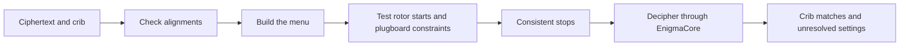

# Enigma Workbench Bombe decipher plan

**Status** — Proposed. Implementation requires approval.

## Proposed scope

Add a **Decipher** view with two paths. **Known settings** accepts ciphertext
and a complete machine configuration, then produces the plaintext using
Enigma's reciprocal operation. **Bombe search** accepts ciphertext, a crib
(a plausible fragment of the original message), and the machine settings the
user already knows. It searches for settings consistent with that crib and
shows what still needs checking.

The historical reference is the Turing–Welchman Bombe. Turing used relationships
between the crib and ciphertext to build a *menu*. Gordon Welchman's diagonal
board used the reciprocal nature of the plugboard to rule out more settings.
The Bombe produced *stops* for further checking. The Workbench can reproduce
that sequence in software by building a menu, testing settings, and replaying
the ciphertext through the existing Enigma core.
[Turing's *Bombe and Spider*](https://academic.oup.com/book/42030/chapter-abstract/355745257) · [The National Museum of Computing's reconstruction](https://www.tnmoc.org/bombe) · [Menus and cribs](https://www.tnmoc.org/bh-16-menus-and-cribs)

| Path | Initial scope |
| --- | --- |
| Known settings | Use the existing three- to five-rotor Workbench configurations. Start at the configured window letters with the given rings and plugboard. |
| Bombe search | Start with the Workbench's three-rotor I–II–III profile, Reflector B, and user-supplied ring settings. Search the 17,576 starting window settings at a supplied or automatically selected crib position. Allow known plugboard leads and infer the leads constrained by the crib. |
| Expanded search | Add a three-rotor order selector using I through V once the first profile is verified. Searching all 60 orders and recovering unknown rings are separate scope decisions backed by measurements. |

With fixed rotor order and rings, there are `26³` starts per crib alignment.
Trying all orders raises that to `60 × 26³` starts. Trying every ring setting
would multiply the count by another `26³`. The initial scope keeps the search
bounded and makes the assumptions visible in the result. An expanded ring
search would also have to recognize equivalent settings. In the current
stepping model, shifting the leftmost ring and starting window by the same
amount leaves its wiring offset and the stepping behavior identical.

## What to reuse

| Existing code | Proposed work |
| --- | --- |
| [`Session`](src/workbench/Session.cpp) constructs rotors and holds the starting settings, tape, and plugboard. | Define a validated machine settings value that can be copied from the Workbench or assembled from a search result. Move the rotor specifications and machine construction into shared core code as part of this change. |
| [`EnigmaMachine`](src/EnigmaMachine.cpp) owns stepping, signal routing, and `processString`. | Reuse it for known-settings deciphering and candidate replay. Extract the shared stepping and rotor/reflector traversal where needed to evaluate the scrambler at a given position. |
| [`Rotor`](src/Rotor.cpp), [`Reflector`](src/Reflector.cpp), and [`Plugboard`](src/Plugboard.cpp) own the component transformations. | Build search tables from these transformations so changes to wirings, notch handling, or ring offsets have one implementation to follow. |
| [`Layout`](src/workbench/Layout.hpp) and [`View`](src/workbench/View.cpp) draw the instrument. | Give Decipher its own input and result state. Pass that state through the current view layer or the interface described in the [Vulkan migration plan](vulkan-migration-plan.md). |

Keep the search in C++20 and independent of the window and renderer. The
same solver can run under Catch2, the current desktop app, and the proposed
Vulkan app. Build the core and its tests first so progress on either renderer
can proceed independently.

## User workflow

1. Paste ciphertext. Normalize ASCII letters the same way as the Workbench
   tape. Display the normalized letter count and report input beyond the
   240-letter limit before searching. Use normalized text for all offsets.
2. Choose **Known settings** to copy the current Workbench configuration or
   enter the key. Display **Ciphertext** on the input and **Plaintext** on the
   output. Use the starting window letters from the configuration and
   instantiate a fresh machine for each decipher operation.
3. Choose **Bombe search**, enter the crib, and confirm the rotor order and
   rings for the supported profile. Pin the crib to a letter position or
   scan all possible alignments. Label displayed offsets starting at one.
4. Choose the plugboard information available. **Known** fixes the entire
   board, **Known leads** fixes the entered pairs and searches the rest,
   and **Unknown** begins with every socket unconstrained. Show an empty
   **Known** board as an unplugged board. Reject conflicting leads before
   starting the search.
5. Run the search and show alignments examined, rotor starts checked,
   stops found, and the current limit. Allow cancellation while typing
   and navigation remain responsive. Keep the search inputs as a snapshot
   so editing them cannot change an in-progress run.
6. Open a stop to see its rotor order, rings, starting window letters,
   crib position, inferred plugboard pairs, and unresolved sockets. Show a
   plaintext preview with the matched crib highlighted and identify any
   assumptions used to generate it. Keep preview and clipboard actions in
   the Decipher view. Loading a key into the Workbench is an explicit action.

## How the search works

### Build the menu

For each crib placement, compare each crib letter with the ciphertext letter
at that position. Discard placements with an identical letter pair. With
Reflector B, the complete Enigma permutation at any position has no fixed
points. The surviving placement gives a graph with letters as vertices and
one edge per aligned pair. Label each edge with its absolute position in the
normalized ciphertext. Retain repeated letter pairs at different positions
as distinct edges. Show an optional menu diagram from the same graph used
by the solver. [The National Museum of Computing's menu guide](https://www.tnmoc.org/bh-16-menus-and-cribs)

### Evaluate a rotor start

Let `S` be the plugboard permutation and `Rᵢ` the rotor-and-reflector
permutation after the machine steps for ciphertext position `i`. For an
aligned plaintext letter `Pᵢ` and ciphertext letter `Cᵢ`, Enigma has
`Cᵢ = S(Rᵢ(S(Pᵢ)))`. Since `S` is reciprocal, the menu constraint is
`S(Cᵢ) = Rᵢ(S(Pᵢ))`. The reflector also makes each `Rᵢ` reciprocal, so a
menu edge can propagate a known value in either direction.

For a crib at zero-based offset `i`, advance through exactly `i` letters
from the candidate start. Step once more before evaluating the first crib
letter. Use the real stepping routine for the prefix and the rest of the
menu, including turnover and double stepping. Keep the pre-first-letter
windows in the candidate record so replay and the UI agree on what
**Start** means.

### Use reciprocal plugboard constraints

Represent each socket as unassigned, mapped to itself, or paired with a
second socket. Every assignment `S(A) = Z` also imposes `S(Z) = A`. Seed the
mapping with the user's known leads. In a fully known board, explicitly
assign each unpaired socket to itself. The Workbench supports up to ten
non-self pairs.

1. Propagate assignments through the menu until they stabilize. Reject a
   branch if it gives a letter two partners, violates a reciprocal
   assignment, contradicts an earlier value in a loop, or exceeds the pair
   limit.
2. When an unresolved menu vertex remains, choose one with several edges
   and try each compatible partner, including itself. Backtrack through
   disconnected parts of the menu as needed because they all use the same
   plugboard. Save every consistent stop within the selected search budget.
3. Keep unresolved sockets distinct from proven self-maps. For a preview,
   use self-maps for unresolved sockets and label that assumption. The
   user can supply more known leads or a longer crib to narrow the results.

### Verify each stop

Build a fresh `EnigmaMachine` from the candidate settings and preview
completion. Decipher the original ciphertext from its first letter. Check
the resulting plaintext at the exact normalized crib position before showing
a match. A stop can fit the crib and still have several plugboard completions
or competing rotor starts. Display **Crib match** and the unresolved socket
count. Report **No match in this search** only after finishing the selected
scope. A run interrupted by cancellation or a limit has its own status.

## Runtime and implementation sequence

Start with a deterministic single-worker search and test it against a small
exhaustive reference search. Check cancellation between starts and during
plugboard branching. Bound the time or candidate work and the number of
retained results. The worker owns the search state and publishes immutable
progress and result snapshots. Keep the ciphertext, crib, and results local
to the app. Diagnostic logs can record counts and timings.

Measure the first version before adding concurrency or larger search spaces.
For one fixed rotor order and ring combination, a scrambler table keyed by
the three current windows needs `26³ × 26` bytes when each contact occupies
one byte. Cache that table only if profiling shows repeated scrambler
evaluation dominates runtime. Keep the first implementation deterministic
by using a fixed start, alignment, and plugboard branching order.

| Phase | Work and checkpoint |
| --- | --- |
| 1. Share machine settings | Extract the rotor catalog and settings construction. Add a known-settings decipher path. All eight existing tests pass, and the same key deciphers a message from a fresh start across all supported rotor counts. |
| 2. Prove the search with a known plugboard | Add crib alignment and menus. Search the three-rotor profile at given rings with a fixed board. Recover the expected starting windows from a documented fixture, including a crib that begins partway through the message. |
| 3. Infer plugboard leads | Add reciprocal propagation, branching, and full-message replay. Compare candidate sets with an exhaustive test oracle on a restricted fixture. Show ambiguous stops with their assumptions. |
| 4. Add the Decipher view | Connect input, progress, cancellation, menu, and results. Compare the same search through the view and the headless tests. Document one walkthrough using a message generated by the Workbench. |
| 5. Measure expanded scope | Benchmark scan-all-alignments and multiple rotor orders on representative inputs. Use timings and candidate counts to decide whether to add order or ring recovery to the interface. |

## Acceptance checks

- A known key recovers the expected A–Z plaintext from a fixed reference
  case. Use a cross-checked reference ciphertext as well as round trips so
  two paths through the same core cannot conceal a shared mistake.
- A fixture with start letters **A D V** steps to **A E W**, then **B F X**
  with I–II–III. A crib starting after the first letter proves that the
  search uses the same turnover timing and absolute positions as replay.
- Confirm scrambler reciprocity, rejection of self-letter alignments, the
  reciprocal pair limit, and contradiction handling. Compare the solver
  with an exhaustive oracle for small connected and disconnected menus.
- Cover known, partial, and unknown plugboards. Include a fixture where
  the true key survives and a fixture with multiple valid stops. Verify that
  an unresolved socket survives transfer to the view and stays distinct from
  a known fixed point in the UI.
- Cover too-long inputs, impossible crib placement, exhausted searches,
  result limits, cancellation, restart, and a late result from a previous
  job. Compare the original Workbench state before and after the search.
  Run the core suite under the existing Mise release and sanitizer tasks.

## Approval

Approval covers known-settings deciphering and the fixed-order, fixed-ring
Bombe search described above. The solver can be implemented on its own while
the renderer choice is reviewed. Choose whether to front-load additional
rotor orders only after the fixed-order search has a measured baseline.
