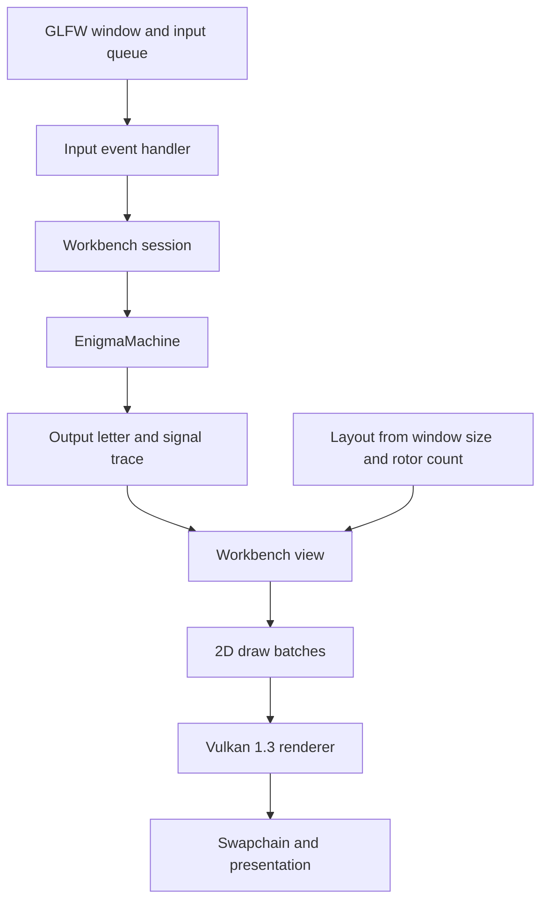

# Architecture {#architecture}

@tableofcontents

`EnigmaCore` implements the cipher in C++20. The Vulkan 1.3 application handles
windowing and input through GLFW and GPU rendering with dynamic rendering.
The app and the test suite link to the same core library.

## Components {#architecture_components}

| Component | Responsibility |
| --- | --- |
| @ref EnigmaMachine | Steps the rotors, routes the signal, and returns a @ref SignalTrace. |
| @ref workbench::Session | Stores message text, plugboard pairs, and the start and ring settings for all five slots. Builds the live machine with three to five active rotors. |
| `workbench/Input.cpp` | Processes keyboard, mouse, and clipboard events and dispatches actions to the session. |
| `workbench/Layout.cpp` | Calculates widget coordinates and hitboxes from the window size and active rotor count. |
| `workbench/View.cpp` | Emits 2D drawing commands for the workbench controls and active signal trace. |
| `workbench/VulkanRenderer.cpp` | Owns the Vulkan 1.3 instance, device, swapchain, pipelines, and frame synchronization. |
| `workbench/DrawCommand.cpp` | Batches 2D primitives and tessellates shapes into GPU vertex and index buffers. |
| `workbench/FontAtlas.cpp` | Uses FreeType to rasterize glyphs and pack font atlases. |
| `workbench/ImageDecoder.cpp` | Decodes the historical museum photo using libjpeg-turbo. |

## From input to display {#architecture_frame}

Typing a letter advances the existing machine and appends to both tapes.
Changing a rotor setting or plugboard lead rebuilds the machine from the
saved settings and replays the input tape. Backspace uses the same replay
path to restore the positions and trace from before the deleted letter.

## Tests {#architecture_tests}

Run `mise run test` from the repository directory. The suite covers reciprocal
encryption, trace order, and session replay when the message or rotor count
changes.
