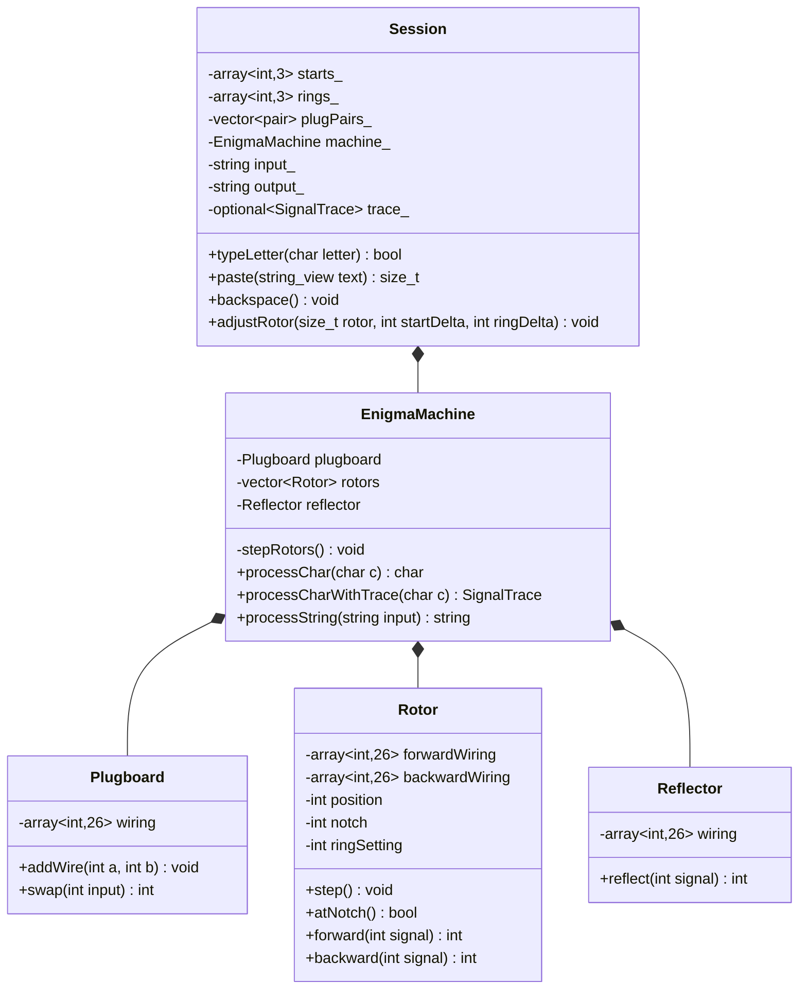
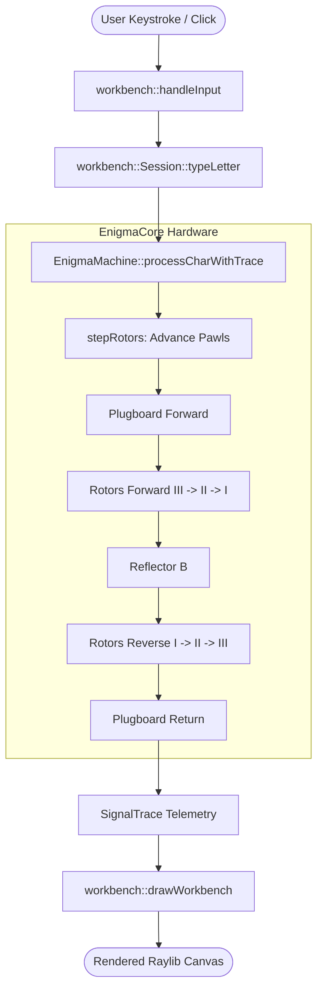

# Architecture Overview {#architecture}

High-level system design and component relationships in Enigma Workbench.

## System Overview

Enigma Workbench separates the cryptographic hardware simulation from the Raylib interactive interface:
- **EnigmaCore**: Pure C++20 cryptographic engine modeling mechanical hardware (rotors, reflector, plugboard, stepping pawls). Has zero GUI dependencies and can be compiled standalone or into headless test suites.
- **Workbench UI**: An interactive Raylib interface maintaining typing sessions, signal telemetry visualization, modal photo viewer, and responsive layouts.

## Data and Event Flow

When a user types a letter or clicks the GUI keyboard:
1. `workbench::handleInput` catches the event.
2. `workbench::Session::typeLetter` appends the character to the session buffer.
3. The internal `EnigmaMachine::processCharWithTrace` steps the rotors, traces the electrical signal through every component, and returns the ciphertext letter along with a `SignalTrace`.
4. `workbench::drawWorkbench` renders the updated ciphertext tape, lights up the corresponding lamp on the lampboard, and draws the stage-by-stage path in the signal visualizer.

