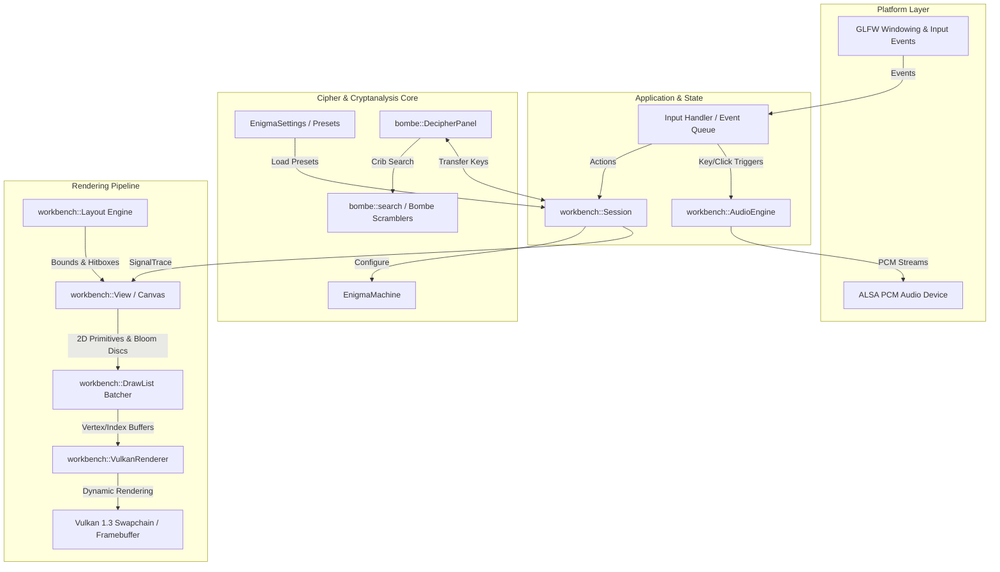

# Architecture {#architecture}

@tableofcontents

Enigma Workbench is structured as a modular modern C++20 application with a decoupled cipher core,
a high-performance Turing-Welchman Bombe search engine, zero-asset procedural mechanical audio synthesis,
and a custom Vulkan 1.3 2D rendering pipeline with dynamic rendering.

## System Overview {#architecture_overview}

## Key Components {#architecture_components}

| Component | Header / Location | Responsibility |
| --- | --- | --- |
| @ref EnigmaMachine | `include/EnigmaMachine.hpp` | Executes rotor stepping, reciprocal signal flow, and captures granular @ref SignalTrace stages. |
| @ref Rotor | `include/Rotor.hpp` | Models scrambler wheels with forward/backward wiring, ring offsets, single/dual turnover notches, and stationary Greek rotor modes. |
| @ref Reflector | `include/Reflector.hpp` | Implements 13-pair reciprocal reflection for Reflectors A, B, C, Thin Bruno, and Thin Caesar. |
| @ref Plugboard | `include/Plugboard.hpp` | Handles pairwise character transpositions (*Steckerbrett*) with validation against duplicate or self-connections. |
| `enigma::historicalPresets()` | `include/EnigmaSettings.hpp` | Authenticated wartime *Tagesschlüssel* codebook presets (Barbarossa, Triton Shark, Wolfpack, Normandy, Scharnhorst). |
| @ref workbench::Session | `src/workbench/Session.hpp` | Holds message tapes, start/ring configurations, plugboard leads, historical presets, and undo/replay management. |
| @ref workbench::AudioEngine | `src/workbench/AudioEngine.hpp` | Procedural mechanical audio synthesizer generating zero-asset key strikes, ratchet turnover clicks, and plug snaps. |
| `bombe::search()` | `include/bombe/Bombe.hpp` | Multi-threaded Turing-Welchman Bombe search engine supporting rotor permutations, reflector options, and crib constraint propagation. |
| @ref bombe::DecipherPanel | `src/bombe/DecipherPanel.hpp` | Modal cryptanalysis workstation with known-key deciphering, crib search, animated scrambler drum bank, and throughput telemetry. |
| `workbench/Layout.cpp` | `src/workbench/Layout.hpp` | Calculates responsive geometric layouts, button hitboxes, lamp centers, key travel bounds, and signal tracks. |
| `workbench/View.cpp` | `src/workbench/View.hpp` | Emits draw batches for the brass lampboard, typewriter keycaps, Bezier patch cords, rotors, and signal path. |
| `workbench/DrawCommand.cpp` | `src/workbench/DrawCommand.hpp` | Batches 2D quads, anti-aliased lines, circles, multi-ring bloom discs, and cubic Bezier patch cords. |
| `workbench/VulkanRenderer.cpp` | `src/workbench/VulkanRenderer.hpp` | Manages Vulkan 1.3 instance, physical/logical devices, swapchain, pipeline layouts, shaders, and dynamic rendering. |
| `workbench/FontAtlas.cpp` | `src/workbench/FontAtlas.hpp` | Packs FreeType glyph bitmaps into GPU textures and computes precise typographic metrics. |
| `workbench/ImageDecoder.cpp` | `src/workbench/ImageDecoder.hpp` | Rapid decompression of the Imperial War Museum Enigma photograph using libjpeg-turbo. |

## Procedural Mechanical Audio Engine {#architecture_audio}

Rather than relying on static pre-recorded WAV samples, the Enigma Workbench features an internal
mathematical sound synthesis engine (`workbench::AudioEngine`):
- **Key Strike Synthesis**: Models the impact of a steel typewriter key striking the mechanical stop, followed by a resonant metallic ping (~36ms duration) composed of exponentially decaying damped sinusoids.
- **Ratchet Turnover Synthesis**: Models the mechanical pawl falling into the rotor ratchet teeth and detent spring snap (~48ms duration) with short broadband noise burst and low-frequency casing resonance.
- **Plugboard Socket Snap**: Models the insertion of a brass banana plug into a spring-loaded Stecker socket (~28ms duration) with sharp contact transient.
- **ALSA PCM Streaming**: Runs an asynchronous audio thread writing 44.1 kHz 16-bit mono PCM buffers. If ALSA is unavailable (e.g. CI environments, headless servers, or missing sound hardware), the engine automatically degrades to a safe no-op mode without throwing exceptions or blocking the frame loop.
- **Sound Toggle**: The audio engine can be muted or unmuted at runtime via the `Sound on` / `Sound off` toolbar button.

## Turing-Welchman Bombe Engine {#architecture_bombe}

The Bombe cryptanalysis subsystem (`bombe::search`) replicates the logical constraint propagation
designed by Alan Turing and Gordon Welchman at Bletchley Park:
- **Crib Alignment**: Scans candidate alignments of a known crib against the ciphertext, immediately filtering out positions where any crib character matches the ciphertext (violating the reflector's non-self-encryption property).
- **Hypothesis Testing**: For each rotor order, reflector, and starting window setting, constructs a menu of letter implications and checks for circuit contradictions.
- **Rotor Order & Reflector Scoping**: Supports searching fixed orders (I–II–III), all permutations of three rotors (6 orders), or all permutations of five rotors (60 orders), paired with Reflector B, Reflector C, or both.
- **Real-Time Telemetry & Scrambler Animation**: Streams progress callbacks reporting throughput (Megakeys/sec), viable offsets, and matches, while driving the 3-drum visual scrambler bank in the Decipher dialog.

## Vulkan 1.3 Rendering Pipeline {#architecture_vulkan}

The user interface is rendered through a dedicated Vulkan 1.3 engine:
- **Dynamic Rendering**: Utilizes `VK_KHR_dynamic_rendering` (standard in Vulkan 1.3), eliminating the overhead of legacy Vulkan render passes and framebuffers.
- **Batching**: The `DrawList` accumulates textured quads (text, museum photo), solid geometry, and multi-ring bloom gradients into cohesive vertex/index buffers.
- **Synchronization**: Employs double-buffering with Vulkan fences and semaphores to ensure tear-free presentation and optimal frame pacing.

On resize, the renderer passes the previous swapchain to Vulkan and continues
with the replacement. It releases the old image views and semaphores after
their frame submissions and presentation waits are finished. Drivers with
swapchain maintenance support provide presentation fences. On other drivers,
the renderer waits for evidence that an already-presented image on a newer
swapchain has been reacquired. [Khronos swapchain recreation guide](https://docs.vulkan.org/samples/latest/samples/api/swapchain_recreation/README.html)

CMake checks generated SPIR-V against Vulkan 1.3 when `spirv-val` is installed.
CI requires the validator with `ENIGMA_REQUIRE_SHADER_VALIDATION=ON`. The
`EnigmaValidateShaders` target runs the checks directly.

## Testing and Quality Assurance {#architecture_tests}

The test suite in `test/test_main.cpp` and `test/bombe_panel_tests.cpp` provides comprehensive verification:
- Cryptographic reversibility and known historical test vectors.
- Single and dual turnover notch stepping across Rotors I through VIII.
- Greek rotor stationary operation and thin reflector pairing on Enigma M4.
- WWII Tagesschlüssel presets loader accuracy.
- Layout responsiveness, hit tests, and modal priority handling.
- Bombe crib constraint resolution and candidate inference.
- AddressSanitizer and UndefinedBehaviorSanitizer clean execution (`mise run sanitize`).
