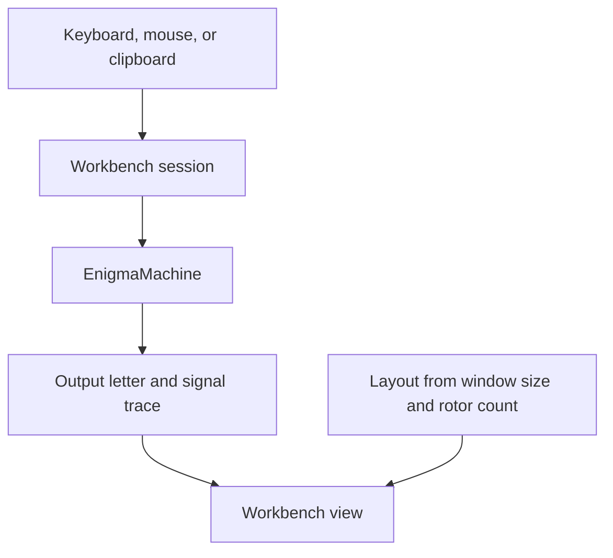

# Architecture {#architecture}

@tableofcontents

`EnigmaCore` implements the cipher in C++20. The Raylib application handles
input and drawing. The app and the test suite link to the same core library.

## Components {#architecture_components}

| Component | Responsibility |
| --- | --- |
| @ref EnigmaMachine | Steps the rotors, routes the signal, and returns a @ref SignalTrace. |
| @ref workbench::Session | Stores message text, plugboard pairs, and the start and ring settings for all five slots. Builds the live machine with three to five active rotors. |
| `workbench/Input.cpp` | Sends keyboard, mouse, and clipboard input to the session. |
| `workbench/Layout.cpp` | Calculates the controls and signal columns from the window size and active rotor count. |
| `workbench/View.cpp` | Draws the machine and displays the latest signal trace. |

## From input to display {#architecture_frame}

Typing a letter advances the existing machine and appends to both tapes.
Changing a rotor setting or plugboard lead rebuilds the machine from the
saved settings and replays the input tape. Backspace uses the same replay
path to restore the positions and trace from before the deleted letter.

## Tests {#architecture_tests}

Run `mise run test` from the repository directory. The suite covers reciprocal
encryption, trace order, and session replay when the message or rotor count
changes.
