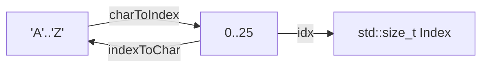

# Charactermap Module {#charactermap_guide}

Detailed guide for uppercase ASCII character arithmetic.

The Charactermap module provides foundational utility functions used throughout the Enigma project to convert between human-readable `char` representations (like `'A'`, `'B'`, `'Z'`) and 0-indexed integer representations (like `0`, `1`, `25`) used internally by the simulated machine hardware.

## Functions

### `int charToIndex(char c)`
- **Description**: Converts a standard uppercase character to its 0-indexed integer equivalent.
- **Parameters**: `c` (char): An uppercase alphabetic character (`'A'` through `'Z'`).
- **Returns**: An integer between `0` and `25`.
- **Validation**: Runtime assertion (`assert`) ensuring `c >= 'A' && c <= 'Z'`.

### `char indexToChar(int i)`
- **Description**: Converts a 0-indexed integer back into its uppercase character equivalent.
- **Parameters**: `i` (int): An integer between `0` and `25`.
- **Returns**: A `char` corresponding to the alphabet letter.
- **Validation**: Runtime assertion ensuring `i >= 0 && i < 26`.

### `std::size_t idx(int i)`
- **Description**: A safe cast function designed specifically for using integer signals as array indices. Many internal data structures (like `std::array<int, 26>`) require `std::size_t` for indexing.
- **Parameters**: `i` (int): An integer signal between `0` and `25`.
- **Returns**: The input integer cleanly cast to `std::size_t`.
- **Validation**: Runtime assertion ensuring `i >= 0 && i < 26` before casting.
