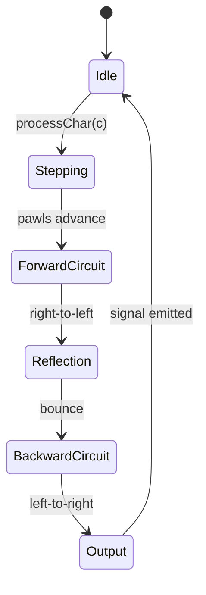

# Enigma Machine Simulation {#enigmamachine_guide}

Chassis integration and multi-rotor coordination.

The `EnigmaMachine` acts as the central chassis and orchestrator for the entire simulation. It holds all the individual components (plugboard, rotors, reflector) together, manages the mechanical stepping of the rotors, and routes the electrical signal through the complete circuit.

## Methods
- `EnigmaMachine(Plugboard p, std::vector<Rotor> r, Reflector ref)`
- `const std::vector<Rotor> &getRotors() const`
- `const Plugboard &getPlugboard() const`
- `void stepRotors()`
- `char processChar(char c)`
- `SignalTrace processCharWithTrace(char c)`
- `std::string processString(const std::string &input)`
