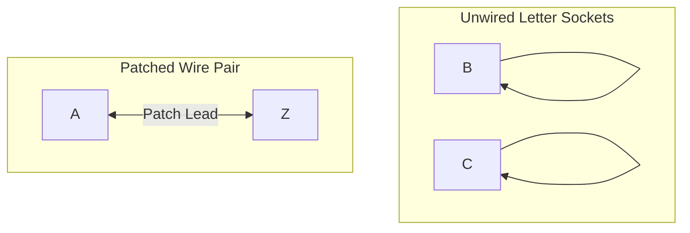

# Plugboard (Steckerbrett) {#plugboard_guide}

Detailed documentation for the plugboard component.

The `Plugboard` (or Steckerbrett) was a component located at the front of the historical Enigma machine. It allowed the operator to swap pairs of letters before the signal entered the rotors, and again after it exited the rotors, adding significant cryptographic complexity.

## Mathematical Properties
- **Involution**: Swapping twice returns the original input: \f$P(P(x)) = x\f$.
- **Capacity**: Supports up to 10 patch leads (20 letters), leaving 6 letters self-steckered.

## Class Overview
The `Plugboard` class maintains a `std::array<int, 26>` called `wiring` which stores the mapping of each character index.

## Methods
- `Plugboard()`: Initializes a blank plugboard where every letter maps to itself.
- `void addWire(int a, int b)`: Connects a physical wire between two letter indices.
- `int swap(int input) const`: Processes an electrical signal passing through the plugboard.
