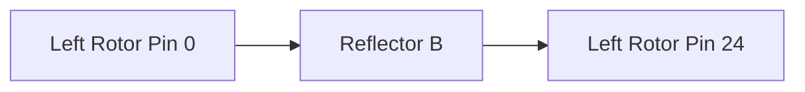

# Reflector (Umkehrwalze) {#reflector_guide}

Detailed documentation for the reflector component.

The `Reflector` (or Umkehrwalze) is the final component in the Enigma signal path before the signal travels backward through the rotors. It takes an incoming signal and rigidly routes it to a different output wire. This component is what guarantees the Enigma machine's reversibility (encrypting and decrypting are the exact same operation).



## Historical Reflector B Layout
```
Input:   A B C D E F G H I J K L M N O P Q R S T U V W X Y Z
Output:  Y R U H Q S L D P X N G O K M I E B F Z C W V J A T
```

## Cryptographic Invariants
1. \f$R(x) \neq x\f$: A letter can never encrypt to itself.
2. \f$R(R(x)) = x\f$: Symmetric involution enabling reciprocal operation.

## Methods
- `explicit Reflector(const std::string &wiringConfig)`: Initializes with 26-character layout string.
- `int reflect(int signal) const`: Passes signal through the reflector's internal wiring.
