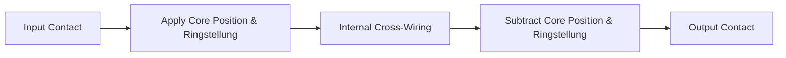

# Rotor (Walze) {#rotor_guide}

Detailed documentation for rotor scrambling, ringstellung, and notch advancement.

The `Rotor` (or Walzen) is the heart of the Enigma machine's cryptography. Rotors consist of complex internal cross-wirings that scramble the electrical signal. Furthermore, they physically rotate, changing the wiring configuration with every keystroke.

## Historical Military Rotors (I, II, III)

| Rotor | Wiring Layout | Turnover Notch |
|---|---|---|
| **I** | `EKMFLGDQVZNTOWYHXUSPAIBRCJ` | **Q** (at R step) |
| **II** | `AJDKSIRUXBLHWTMCQGZNPYFVOE` | **E** (at F step) |
| **III** | `BDFHJLCPRTXVZNYEIWGAKMUSQO` | **V** (at W step) |

## Methods
- `Rotor(const std::string &wiring, char notchChar, int initRingSetting = 0)`
- `void setPosition(int p)`
- `int getPosition() const`
- `void setRingSetting(int r)`
- `bool atNotch() const`
- `void step()`
- `int forward(int signal) const`
- `int backward(int signal) const`
