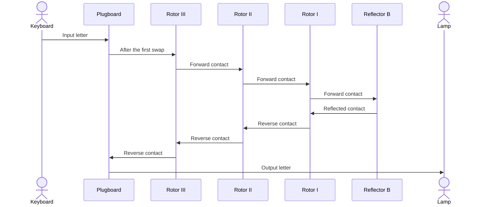

# Signal path {#signal_flow}

@tableofcontents

Press a key to see the route on the **Signal path** panel. The rotors
step first. The top row follows the signal from the key to Reflector B.
The bottom row follows it back through the machine to the lamp.

## Three-rotor example {#signal_example}

With four or five rotors, the signal enters the rightmost active rotor after
the plugboard and passes through every rotor on both legs of the trip.

## Read the trace {#signal_trace_fields}

| Field in @ref SignalTrace | What it records |
| --- | --- |
| `input` | The pressed letter |
| `plugboardForward` | The letter after the first plugboard swap |
| `rotorForward` | Output of each rotor, from right to left |
| `reflected` | Reflector B output |
| `rotorBackward` | Output of each rotor on the return path, from left to right |
| `output` | The last plugboard result, shown on the lamp and output tape |
