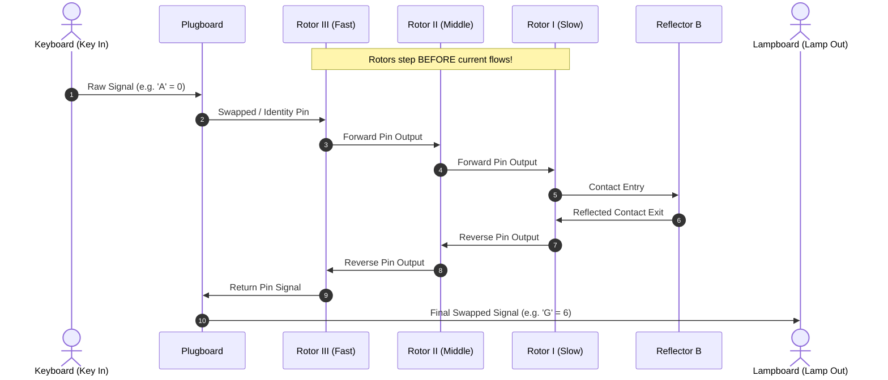

# Signal Flow & Cryptographic Path {#signal_flow}

Detailed walkthrough of electrical signal propagation through the Enigma circuit.

## Closed Circuit Principle

In a physical Enigma machine, pressing a key closes a battery circuit. The electrical current travels forward through:
1. The **Plugboard** (Steckerbrett)
2. The **Rotor Bank** (Walzensatz, right-to-left: Rotor III -> Rotor II -> Rotor I)
3. The **Reflector** (Umkehrwalze B)
4. The **Rotor Bank in reverse** (left-to-right: Rotor I -> Rotor II -> Rotor III)
5. The **Plugboard again**
6. Finally energizing a bulb on the **Lampboard**.

## Signal Trace Telemetry

The simulator tracks each hop using the `SignalTrace` struct:

| Stage | Field in SignalTrace | Description |
|---|---|---|
| Input | `input` | Pressed uppercase letter |
| Plugboard In | `plugboardForward` | Character exiting plugboard entering Rotor III |
| Rotor Forward | `rotorForward` | Vector of characters exiting Rotors III, II, and I |
| Reflector | `reflected` | Character bounced back by Reflector B |
| Rotor Reverse | `rotorBackward` | Vector of characters exiting Rotors I, II, and III in reverse |
| Output | `output` | Final illuminated lampboard letter |

## Rotor Coordinate Translation

At each rotor contact, the electrical signal undergoes pin-to-wire shifting dictated by:
\f[
\text{contact}_{\text{in}} = (\text{signal} + \text{position} - \text{ringSetting}) \bmod 26
\f]
\f[
\text{signal}_{\text{out}} = (\text{wiring}[\text{contact}_{\text{in}}] - \text{position} + \text{ringSetting} + 26) \bmod 26
\f]

Because the inverse wiring is precomputed during initialization, reverse flow evaluates in \f$O(1)\f$ time without runtime array searches.
