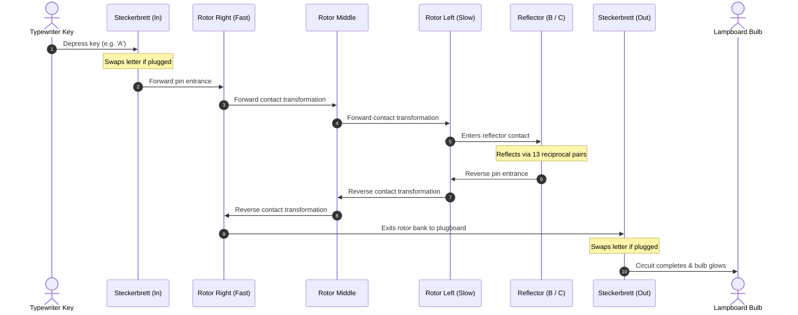
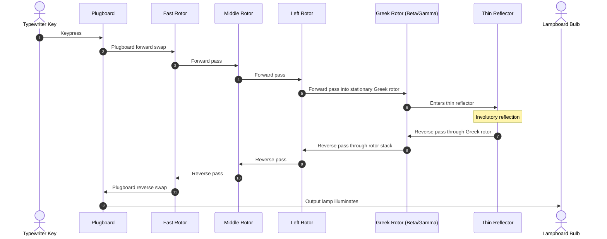

# Signal Path and Circuit Flow {#signal_flow}

@tableofcontents

The electrical circuit of an Enigma machine completes instantaneously once a key is depressed and the rotors have stepped.
The current flows from the battery or transformer through the plugboard, across each rotor in right-to-left order,
reflects off the reflector, travels back through the rotors in left-to-right order, passes through the plugboard a second time,
and finally illuminates a lamp on the lampboard.

The Enigma Workbench visualizes this journey in the **Signal path** panel directly below the keyboard and controls, exposing
every intermediate letter stage.

## Circuit Flow Diagrams {#signal_diagrams}

### Standard 3-Rotor Wehrmacht Enigma (M3)



### Kriegsmarine 4-Rotor Enigma M4

In the Kriegsmarine M4, a non-stepping Greek rotor (*Beta* or *Gamma*) and a thin reflector (*Bruno* or *Caesar*)
occupy the leftmost position:



## Reading the Signal Trace {#signal_trace_fields}

Every keypress processed by @ref EnigmaMachine::processCharWithTrace generates a @ref SignalTrace
recording each intermediate contact.

| Field in @ref SignalTrace | Stage description | Visual representation in Workbench |
| --- | --- | --- |
| `input` | The pressed keycap character | Highlighted typewriter keycap |
| `plugboardForward` | Character after initial plugboard swap | Plugboard cable input socket |
| `rotorForward` | Vector of contact letters traversing rotors right-to-left | Top row of the Signal Path display |
| `reflected` | Reflected contact exiting the reflector | Leftmost turnaround point in the signal path |
| `rotorBackward` | Vector of contact letters traversing rotors left-to-right | Bottom row of the Signal Path display |
| `output` | Final character exiting the second plugboard pass | Glowing optical bloom bulb on the lampboard |

## Mathematical Formulation {#signal_math}

Let $P$ denote the plugboard permutation ($P = P^{-1}$).
Let $R_i$ denote the permutation of the $i$-th rotor given its rotational position $p_i$ and ring setting $r_i$.
Let $U$ denote the reflector permutation ($U = U^{-1}$).

For an $N$-rotor configuration ($i = 1$ rightmost fast rotor, $i = N$ leftmost rotor):
```text
E_K = P * R_1^-1 * R_2^-1 * ... * R_N^-1 * U * R_N * ... * R_2 * R_1 * P
```

Because $P = P^{-1}$ and $U = U^{-1}$, the entire composite mapping $E_K$ is symmetric and involutory:
```text
E_K^-1 = E_K
```
This mathematical identity guarantees that ciphering is completely reversible when the same machine settings $K$ are applied.
