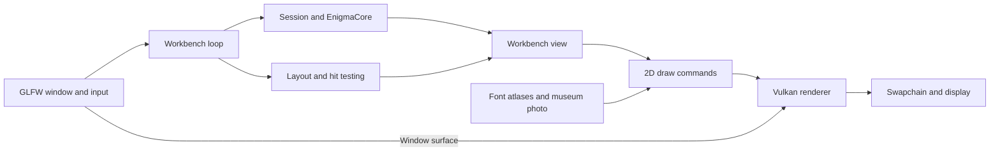

# Enigma Workbench Vulkan migration plan

**Status** — Implemented. Cutover to Vulkan 1.3 complete.

## Proposed scope

Replace Raylib with a renderer written against the Vulkan C API from C++20.
Enigma will create the Vulkan instance, device, swapchain, pipelines, buffers,
and textures, and own their synchronization and cleanup. Keep GLFW for desktop
windows, events, clipboard access, and creation of the Vulkan window surface.
Create the window with `GLFW_NO_API`. FreeType will rasterize the existing fonts
on the CPU, and libjpeg-turbo will decode the bundled museum photograph.
[GLFW Vulkan guide](https://www.glfw.org/docs/3.4/vulkan_guide.html)

Use Vulkan 1.3 as the minimum runtime version. Dynamic rendering and
synchronization2 give the Workbench a small rendering path using one color
attachment, with no depth buffer or render-pass objects. Confirm the device
features and window presentation support at startup. The initial verification
targets are Linux with X11 or XWayland and Windows. Test native Wayland
separately before advertising support, especially for clipboard and scaling.
macOS would need a separate MoltenVK compatibility pass.
[Vulkan version and porting guide](https://docs.vulkan.org/guide/latest/versions.html)

If “bare metal” includes native windowing, the same renderer can use an XCB
window on Linux and a Win32 window on Windows. That scope also includes writing
the platform event loops, keyboard mapping, clipboard handling, and DPI
behavior. Choose that route before the platform code is written. The rest of
this proposal assumes GLFW.

## What changes in the current code

| Current code | Proposed change |
| --- | --- |
| [`src/main.cpp`](src/main.cpp) owns Raylib startup, the application loop, and cleanup. | Keep one application loop. Give the platform code ownership of the window and the Vulkan renderer ownership of all GPU objects. |
| [`Layout.hpp`](src/workbench/Layout.hpp) uses Raylib `Rectangle` and `Vector2`. | Replace those with simple Workbench value types and keep `makeLayout` as the shared geometry for drawing and hit testing. |
| [`Input.cpp`](src/workbench/Input.cpp) polls Raylib for keys, mouse clicks, clipboard text, and time. | Process an ordered queue of text, key, and mouse events. Pass clipboard operations and the current monotonic time to the code that updates `Session` and `InterfaceState`. |
| [`View.cpp`](src/workbench/View.cpp) draws each control and loads fonts and the photo through Raylib. | Keep the drawing logic for the controls. Have it emit 2D draw commands that the Vulkan backend can batch and submit. Move font rasterization and JPEG decoding into asset loading. |
| [`Session.cpp`](src/workbench/Session.cpp) owns the tape, rotor settings, plugboard, and trace. [`EnigmaCore`](include/EnigmaMachine.hpp) owns the cipher. | Reuse both directly. The graphics backend needs the resulting state and trace to draw a frame. |

The platform, view, and renderer each have one concrete implementation after
cutover. The migration can use a temporary second executable to compare the two
renderers through the same Workbench state and controls.

## Window, input, and layout

1. Register the GLFW error callback before initialization. Check every stage
   of window and surface creation and return an actionable error on failure.
   A Linux run with neither `DISPLAY` nor `WAYLAND_DISPLAY` must exit cleanly,
   covering the current startup issue recorded in [bug-security.md](bug-security.md).
2. Use character callbacks for text and key callbacks for shortcuts. Preserve
   ASCII A–Z input, uppercase conversion, `Ctrl+C`, `Ctrl+V`, and Backspace.
   Copy the clipboard string as soon as it is received. Keep paste filtering
   and the 240-letter limit in `Session`. Consume shortcut events once and
   prevent the corresponding character event from adding a letter to the tape.
3. Keep the layout and hit tests in window coordinates. Use framebuffer
   pixels for the swapchain, Vulkan viewport, and scissor rectangles. Convert
   using the actual window and framebuffer dimensions, including when a window
   moves between monitors. Preserve the 1080×720 logical minimum.
4. Apply input in event order. Recompute layout after a size change or a
   rotor-count change before hit testing the next click. Preserve modal input
   priority. Escape closes the photo first and exits from the main window.
   Use a monotonic clock for status expiry so it remains independent of frame
   rate.
5. Render the initial frame and redraw for input, resize, hover changes,
   exposure, or status expiry. Use event waits with a timeout for the next
   status expiry when the view is idle. Pause acquisition when the framebuffer
   is zero-sized, and keep processing events while the window is minimized.
   [GLFW input guide](https://www.glfw.org/docs/3.4/input_guide.html) · [GLFW window guide](https://www.glfw.org/docs/3.4/window.html)

## Vulkan implementation

### Initialization and ownership

- Take the required instance extensions from GLFW. Enable the Khronos
  validation layer and debug messenger in development when available. Read the
  loader and physical device API versions. Query `dynamicRendering` and
  `synchronization2` with `VkPhysicalDeviceVulkan13Features`, then check the
  swapchain extension, queue families, surface capabilities, formats, and
  present modes. Log the chosen device and the reason a device was rejected.
- Prefer one queue family for graphics and presentation. If the selected
  device needs separate families, create both queues and use concurrent
  sharing for swapchain images. Use FIFO presentation initially and prefer an
  sRGB surface format. Clamp image count and extent to the capabilities
  reported for the surface.
- Use small C++ owners for Vulkan handles and check `VkResult` at API boundaries.
  Ensure a partial startup can unwind. Retire in-flight graphics and
  presentation work before destroying the resources it uses. Destroy the
  swapchain and device before the surface, then destroy the instance. Keep the
  native window alive until its Vulkan surface is gone.

### Drawing and assets

- Emit ordered commands for solid and rounded rectangles, circles, line
  segments, text, and textured quads. Convert the shapes to triangles so the
  Workbench is independent of optional wide-line support. Use a shared vertex
  format and two pipelines for solid and sampled draws. Batch adjacent draws
  with the same pipeline, texture, and clip rectangle while preserving paint
  order for overlays and alpha blending.
- Port the graphite panels, amber lamps, five-letter tape groups, two-row
  signal path, keyboard, plugboard, and photo modal. Keep glyph measurement
  and painting on the same font metrics so text remains centered and fits at
  the minimum window size. Start at one sample per pixel and check edges and
  text against the Raylib captures before choosing additional anti-aliasing.
  Blend in linear space on the sRGB target. Treat the photo as sRGB color and
  the glyph atlas as linear coverage.
- Rasterize ASCII plus the existing interface glyphs used for punctuation,
  arrows, and minus signs. Pack the bitmaps and metrics into glyph atlases for
  Instrument Serif, Montserrat, and JetBrains Mono. Preserve advances,
  bearings, and baselines. Rebuild atlases at the new DPI when necessary and
  retire the old textures after their last submitted frame completes.
  [FreeType glyph metrics](https://freetype.org/freetype2/docs/tutorial/step2.html)
- Decode the shipped JPEG to RGBA and reuse one texture for the cropped
  thumbnail and full photo viewer. Validate image dimensions before upload.
  Keep the photo's unavailable state for missing or corrupt files. Use
  another bundled face if a font is missing and report a startup error if
  no face loads or a shader is unavailable. Resolve assets relative to the
  executable or the installation directory so the program runs from a
  different working directory. Preserve bundled artwork and font credits.
  [libjpeg-turbo documentation](https://libjpeg-turbo.org/Documentation/Documentation)
- Stage texture data through host-visible upload buffers into device-local
  images. Use synchronization2 barriers to move images from transfer
  destination to shader read. Keep upload buffers alive through their fence.
  Use mapped per-frame vertex and index buffers and flush non-coherent memory
  on `nonCoherentAtomSize` boundaries when required. Use one graphics queue
  for uploads and rendering initially.

### Frame and swapchain lifecycle

1. Give each of two frame slots a command buffer, submission fence, acquire
   semaphore, and mapped drawing buffers. Give each swapchain image a
   separate semaphore for the presentation wait. Reuse a frame slot only
   after its submission fence and reuse the present-wait semaphore through
   acquisition of its image and the corresponding semaphore wait.
   [Khronos swapchain semaphore reuse guide](https://docs.vulkan.org/guide/latest/swapchain_semaphore_reuse.html)
2. Wait for the current frame slot and acquire an image with a bounded wait
   so the application can return to event processing on timeout. Record the
   transition to color-attachment layout, clear and draw with
   `vkCmdBeginRendering`, and transition to `VK_IMAGE_LAYOUT_PRESENT_SRC_KHR`.
   Reset the frame fence after recording and immediately before submitting
   with `vkQueueSubmit2`. Wait for acquisition before using the image, then
   present with `vkQueuePresentKHR`. A failed submit exits the frame loop
   through the error path so a later frame cannot wait on its reset fence.
3. When acquisition reports `VK_ERROR_OUT_OF_DATE_KHR`, skip submission and
   recreate when the framebuffer has a nonzero size. An acquired image
   with `VK_SUBOPTIMAL_KHR` can finish that frame before rebuilding. Schedule
   recreation if presentation reports either result. Coalesce rapid resize
   notifications and rebuild image views, image sync state, and
   format-dependent pipelines when needed. Preserve textures and the
   Workbench session. Report device or surface loss and exit cleanly in the
   first release.
4. Prefer present fences when `VK_KHR_swapchain_maintenance1` or the
   supported `EXT` equivalent and feature are available. On drivers without
   the extension, follow Khronos's deferred retirement pattern for old
   swapchains during resize. Track presentation completion separately from
   the graphics submission fence. The Vulkan Guide describes waiting idle
   as a practical shutdown fallback on drivers without present fences, with
   a specification limitation. Record which path each test driver uses and
   exercise both with validation.
   [Khronos swapchain recreation sample](https://docs.vulkan.org/samples/latest/samples/api/swapchain_recreation/README.html) · [Present-fence extension](https://docs.vulkan.org/refpages/latest/refpages/source/VK_KHR_swapchain_maintenance1.html)

## Build and dependency plan

| Dependency | Use in the migration |
| --- | --- |
| Vulkan headers, loader, and driver | Build against the SDK or system development packages with `Vulkan::Vulkan`. A compatible runtime loader and driver are installation prerequisites. An unsupported adapter gets an error naming the missing feature or version. |
| GLFW 3.4 or newer | Use the CMake package for the supported desktop backends. Keep its headers in the platform code and let the renderer consume the Vulkan surface. |
| FreeType and libjpeg-turbo | Resolve with CMake and keep CPU-side decoding out of the renderer. Record tested versions and include the applicable dependency notices with distributed artifacts. |
| `glslc` and `spirv-val` | Build GLSL into SPIR-V during the CMake build with `--target-env=vulkan1.3`. Package the generated SPIR-V with the executable and validate it in CI. |
| Catch2, Doxygen, Mise | Keep the current tests, documentation workflow, and Mise entry points. Allow a core-only configure and test run without graphics development packages. |

Keep CMake 3.22 as the project minimum unless a verified dependency requires
a higher one. `Vulkan_GLSLC_EXECUTABLE` is available at that minimum. Attach
shader outputs to the Vulkan target so editing a shader rebuilds and stages it.
Use system packages on Linux and document the SDK and dependency package setup
for Windows. Verify offline builds using already-installed dependencies and
document how the tested packages are obtained. `mise run run` continues to
launch the current app until cutover, after which it launches the Vulkan app.
[CMake FindVulkan](https://cmake.org/cmake/help/latest/module/FindVulkan.html) · [Shaderc glslc manual](https://github.com/google/shaderc/blob/main/glslc/README.asciidoc)

## Implementation sequence and review gates

| Phase | Work | Gate |
| --- | --- | --- |
| 1. Capture the Raylib baseline | Run the eight existing cases and save captures for three, four, and five rotors at default and minimum window sizes. Record input, ciphertext, and the last trace for each capture. Record device and platform capabilities for the first Vulkan test machines. | The same session setup can be reproduced in either backend. The target GPUs expose the required Vulkan 1.3 capabilities. |
| 2. Isolate the Workbench | Move geometry, input handling, viewport conversion, and the drawing commands behind the agreed interfaces. Adapt the Raylib build to consume them during migration. Add focused geometry and input regression cases. | The existing executable still builds and its core, input, and layout tests pass. Baseline captures and behavior agree. |
| 3. Bring up Vulkan | Add a temporary `EnigmaVulkan` executable and Mise task. Open a Vulkan window and render a clear frame, then exercise resize, minimize, restore, and teardown with validation before porting the view. | The frame loop starts and stops cleanly. Resize and missing-display checks pass. Validation reports zero errors attributable to Enigma. |
| 4. Port the interface | Add 2D batching, fonts, and the photo. Wire up the existing view and input, then compare both executables against the baseline. | Cipher output and trace match exactly. All controls remain usable at 1080×720 and high DPI. Review screenshots for spacing, clipping, readability, and color. |
| 5. Switch the default | Make the Vulkan executable `Enigma`, retire the temporary task, and remove the Raylib renderer, dependency, and build flags together. Update README, architecture docs, CI dependencies, and the status of the missing-display issue. | A fresh checkout builds and runs via Mise. Linux and Windows pass the agreed acceptance checks. Core-only tests and `mise run docs` still work. |

Keep phase 5 in a separate source-control change. A defect discovered after
cutover can be handled by reverting that change and running the previous
Raylib build while the Vulkan fix is tested. Both executables use the same
message format and machine settings.

## Acceptance and risk checks

- **Cipher and controls.** Require all eight current Catch2 cases, then compare
  identical scripted input on both backends. Cover adding and removing rotors,
  restoring saved ring and start settings, replay after edit or Backspace,
  plugboard pairing and replacement, Clear versus Reset, and full ciphertext
  copy at the tape limit. Check the modal with both keyboard and mouse. Check
  that one keypress or paste shortcut produces exactly one intended action.
- **Graphics lifecycle.** Exercise repeated creation and shutdown, rapid
  resizing, minimize and restore, and movement between displays with different
  scaling. Test with validation and synchronization validation enabled. Run
  a bounded smoke test on Linux under a virtual X server with Mesa Lavapipe,
  plus a graphics check on a real device. Run a Windows build and desktop
  smoke check before replacing the default Windows command. The desktop
  checks cover the target GPU drivers and window managers.
  [Khronos validation layer settings](https://github.com/KhronosGroup/Vulkan-ValidationLayers/blob/main/docs/updating_from_VK_EXT_validation_features.md)
- **Failure paths.** Start with an unavailable display, an unsupported Vulkan
  adapter, a missing shader, and a corrupted photo. Test launch from another
  working directory and partial initialization cleanup. Require clear errors
  and zero validation errors from Enigma resource use. Keep release and
  ASan/UBSan tests in CI for CPU-side behavior.
- **Visual and performance parity.** Compare the three rotor counts at 1080×720
  and 1320×840 and check a high-DPI run. Compare lamp state, arrow direction,
  label alignment, grouping, modal dimming, and image crop. Allow pixel-level
  differences in text rasterization. Measure frame time and idle CPU use on
  the same reference machine. Investigate observable regressions before
  increasing the rendering or threading complexity.

## Approval

Approval starts phase 1 with direct Vulkan 1.3, GLFW windowing, FreeType,
libjpeg-turbo, and Linux plus Windows as the first cutover targets. If native
windowing is part of the requirement, settle the platform scope before
implementation. Confirm the minimum Vulkan version against the devices that
need to run Enigma before proceeding beyond the baseline phase.
